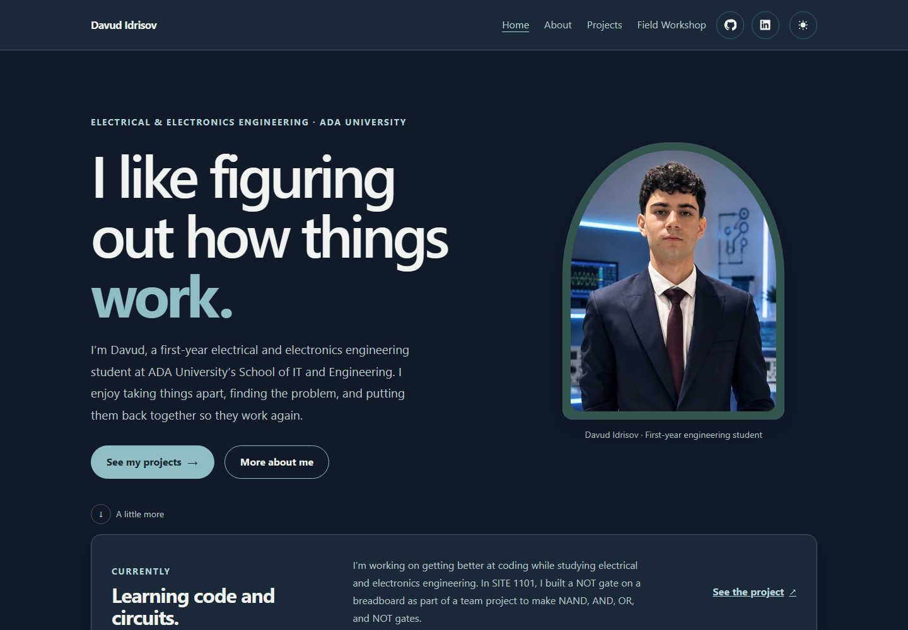
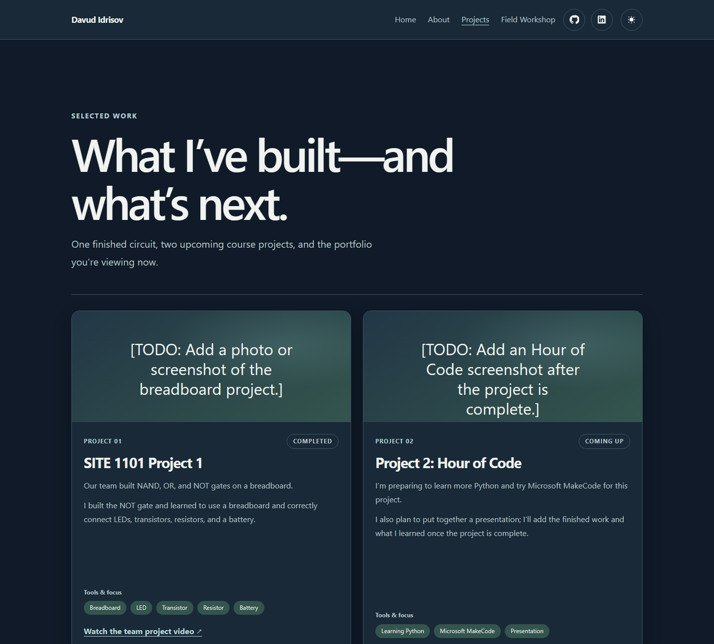

# Davud Idrisov — Portfolio

A personal portfolio for my SITE 1101: Principles of Information Systems course.
I’m a first-year Electrical and Electronics Engineering student at ADA University.
This site brings together my background, coursework, projects, and an interactive
resume game.

**Live site:** [davud09.github.io](https://davud09.github.io/) ·
**Source:** [github.com/Davud09/Davud09.github.io](https://github.com/Davud09/Davud09.github.io)

## The site

### Home



The homepage includes the **Signal Lab**, a four-stage circuit puzzle. The final
stage adds a countdown and a switch sequence. The performance readout uses the
browser's Navigation Timing API to show when the page became interactive; the
result depends on the device and browser.

### Projects



The projects page is populated from [`assets/data/projects.json`](assets/data/projects.json).
The SITE 1101 breadboard project is complete; Hour of Code and Robotics are listed
as upcoming. Photos for those course projects have not been added yet, so the page
labels the missing images rather than presenting placeholders as finished work.
The breadboard team project video is linked from its project card.

## What’s here

- **Home:** introduction, profile photo, browser-measured interactive timing, and
  the four-stage Signal Lab challenge
- **About:** education, practical repair experience, programming skills, activities,
  test scores, languages, and interests
- **Projects:** project cards loaded from JSON and a keyboard-operable image viewer
- **Field Workshop:** a keyboard- and touch-operable interactive resume with map
  stations, XP, achievements, and a link to the plain resume
- Liquid-glass styling across the site, with pointer-responsive highlights and
  click ripples on interactive controls
- Hidden keyboard, logo-click, and theme-toggle easter eggs
- Responsive layout, dark/light themes, keyboard focus styles, reduced-motion support,
  and profile-image fallback

The glass effects respect reduced-motion and reduced-transparency preferences.
The easter eggs are small optional interactions and do not change the site's
pages or core features.

## Built with

- HTML, CSS, and vanilla JavaScript
- JSON project data
- GitHub Pages

There is no build step, framework, or package installation.

## Run locally

The projects page loads its content from JSON, so run the site through a local HTTP
server rather than opening the HTML files directly. From the repository folder:

```powershell
python -m http.server 8000
```

Open [http://localhost:8000](http://localhost:8000) and stop the server with
`Ctrl+C`.

## Project files

```text
.
├── about.html
├── index.html
├── projects.html
├── quest.html
├── content.md
└── assets/
    ├── css/       # Shared and page-specific styles
    ├── data/      # Project-card data
    ├── images/    # Profile photo, favicon, and page screenshots
    └── js/        # Navigation, theme, page behavior, and workshop game
```

## Contact

- [GitHub profile](https://github.com/Davud09)
- [LinkedIn](https://www.linkedin.com/in/davud-idrisov-333a382b0/)
