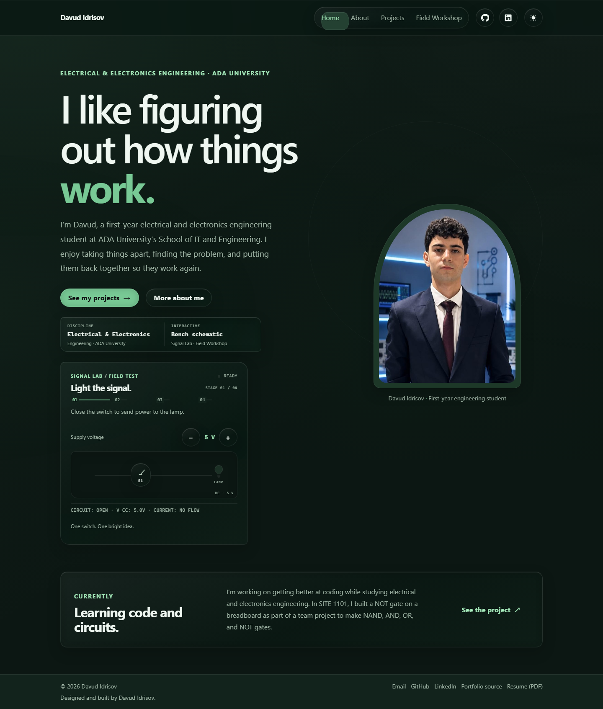
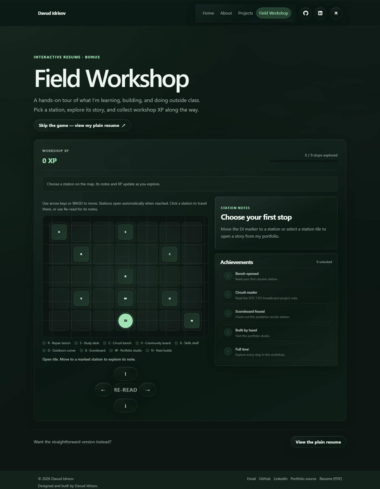

# Davud Idrisov — Portfolio

A personal portfolio for my SITE 1101: Principles of Information Systems course.
I’m a first-year Electrical and Electronics Engineering student at ADA University.
This site brings together my background, coursework, projects, and an interactive
resume game.

**Live site:** [davud09.github.io](https://davud09.github.io/) ·
**Source:** [github.com/Davud09/Davud09.github.io](https://github.com/Davud09/Davud09.github.io)

## The site

### Home



The homepage includes the **Signal Lab**, a four-stage circuit puzzle. Its
accessible voltage controls adjust the circuit from 1 to 12 volts, and the final
stage adds a countdown and a switch sequence. A live readout reports the circuit
state, supply voltage, and whether current is flowing.

### Projects


Project cards are present in the HTML first, so the page still has content when
JavaScript is unavailable. JavaScript enhances them with
[`assets/data/projects.json`](assets/data/projects.json); if that data cannot be
loaded, the static cards remain visible with a retry option. The page includes
the SITE 1101 breadboard project and photos, Hour of Code and Robotics cards
marked **In Progress**, and a project entry for this portfolio. The breadboard
team project video is linked from its card. Project cards show their focus, tools
or components, and status; planned projects use original inline SVG illustrations.
The SITE 1101 carousel starts with the breadboard photo and includes previous/next
controls and pagination dots. Cards open keyboard-operable case-study sheets
with the available photos, build notes, and component or stack details.

### Field Workshop



The interactive resume has nine stations. Move with the arrow keys or WASD, use
the on-screen controls, or select a station to travel to it and open its notes
in a glass sheet. Exploring stations earns XP and unlocks achievements; the
plain resume is also available on the About page.

## What’s here

- **Home:** introduction, profile photo, engineering focus, and the four-stage
  Signal Lab challenge with circuit telemetry
- **About:** education, practical repair experience, programming skills, activities,
  visible skill-level indicators, animated test scores, languages, interests, and
  contact information
- **Projects:** static project cards enhanced from JSON, in-progress project cards,
  photo gallery, and a retry message if project data cannot be loaded
- **Field Workshop:** a keyboard- and touch-operable interactive resume with map
  stations, arrow-key or WASD movement, clickable station tiles, automatic note
  opening and XP, visited markers, a Re-read control, consolidated live feedback,
  achievements, and a link to the plain resume
- **Contact actions:** an email link in the footer and a Resume (PDF) link on
  every page
- Hidden keyboard, logo-click, and theme-toggle easter eggs

## Design, accessibility, and performance

- Shared CSS custom properties keep the color palette, spacing, radii, shadows,
  glass effects, and motion timing consistent.
- A frosted sticky header has a scroll-progress line and a sliding navigation
  pill that carries its position between pages. Cards and controls use glass
  surfaces, highlights, and tactile hover and press feedback.
- Project case studies and selected Workshop stations expand into glass sheets
  and return to their source when closed. Reduced-motion settings replace spatial
  travel with an opacity fade.
- The glass system has opaque fallbacks for browsers without `backdrop-filter`,
  reduced-transparency support, and forced-colors styling. Blur is reduced on
  narrow screens.
- One button system provides primary, secondary, ghost, and icon variants with
  hover, pressed, focus-visible, disabled, and loading states.
- Page-load and scroll reveals, hero parallax, the Signal Lab, Workshop movement,
  XP, and the snap-scrolling project gallery use motion where appropriate.
  Page navigation uses the View Transitions API when available. Reduced-motion
  preferences are respected.
- Semantic landmarks, a skip link, visible keyboard focus, labeled controls, and
  keyboard-operable dialogs support accessible navigation. Case-study and
  station sheets restore focus to their trigger when closed.
- Dark and light themes, responsive layouts, canonical and theme-color metadata,
  Open Graph and Twitter cards, a favicon, and an Apple touch icon are included.
- The default theme uses deep forest-green surfaces and emerald accents; the light
  theme uses cool, pale-green surfaces.
- The added project photos and portfolio screenshot are compressed. Page images
  have dimensions to reduce layout shifts, below-the-fold images are lazy loaded,
  and the homepage portrait is preloaded.

The easter eggs are optional and do not change the site's pages or core features.

## Built with

- HTML, CSS, and vanilla JavaScript
- JSON project data
- GitHub Pages

There is no build step, framework, or package installation.

## Validation

JavaScript syntax and project JSON were checked. Chromium checks covered mobile
and desktop layouts, the project-data fallback and retry, carousel, case-study
and station sheets, reduced motion, Signal Lab telemetry, and Workshop movement
and XP. Safari, Firefox, and 120 fps performance have not been verified.

## Run locally

The projects page loads its content from JSON, so run the site through a local HTTP
server rather than opening the HTML files directly. From the repository folder:

```powershell
python -m http.server 8000
```

Open [http://localhost:8000](http://localhost:8000) and stop the server with
`Ctrl+C`.

## Project files

```text
.
├── about.html
├── index.html
├── projects.html
├── quest.html
├── content.md
└── assets/
    ├── css/       # Shared and page-specific styles
    ├── data/      # Project-card data
    ├── images/    # Profile photo, favicon, and page screenshots
    └── js/        # Navigation, theme, page behavior, and workshop game
```

## Contact

- [GitHub profile](https://github.com/Davud09)
- [LinkedIn](https://www.linkedin.com/in/davud-idrisov-333a382b0/)
- Email: [didrisov28062@ada.edu.az](mailto:didrisov28062@ada.edu.az)

To enable the Resume (PDF) links, add `assets/Davud_Idrisov_CV.pdf`.
